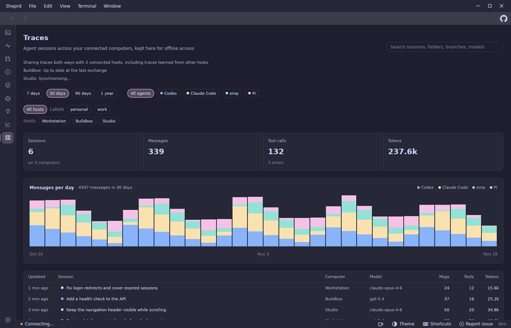
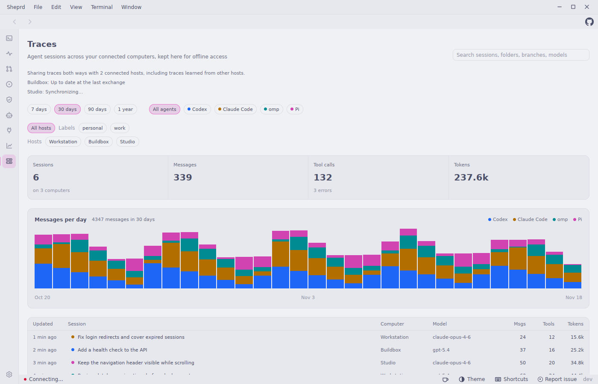
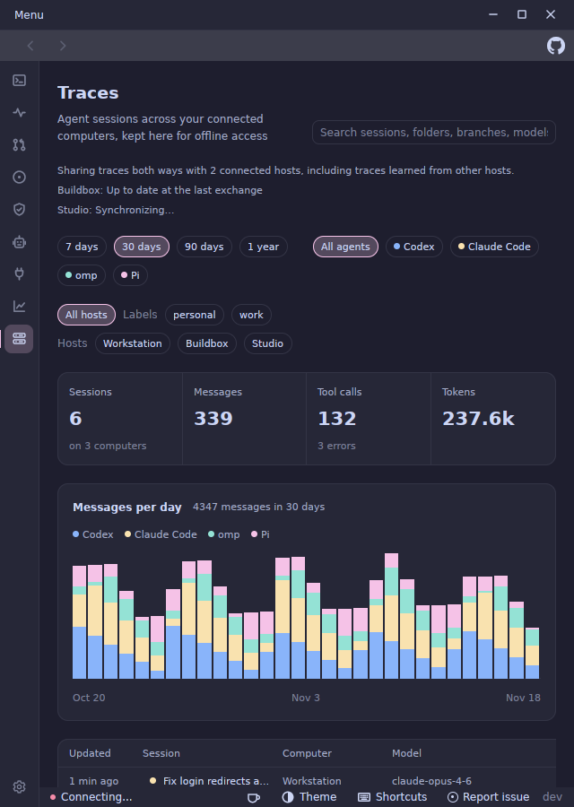
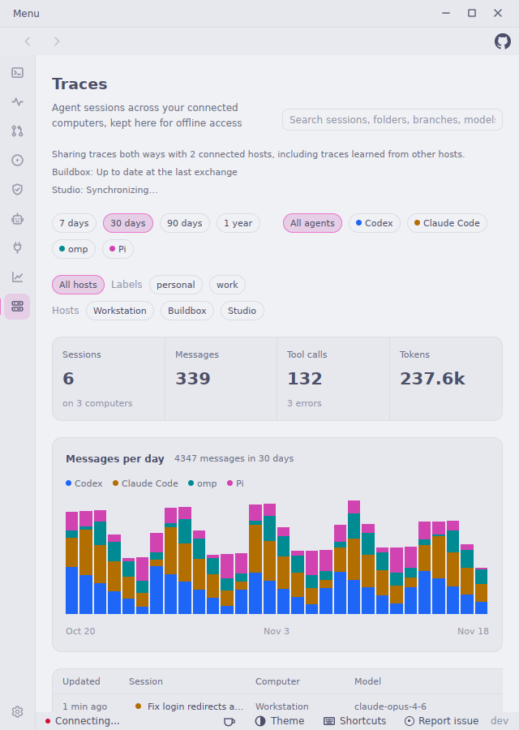
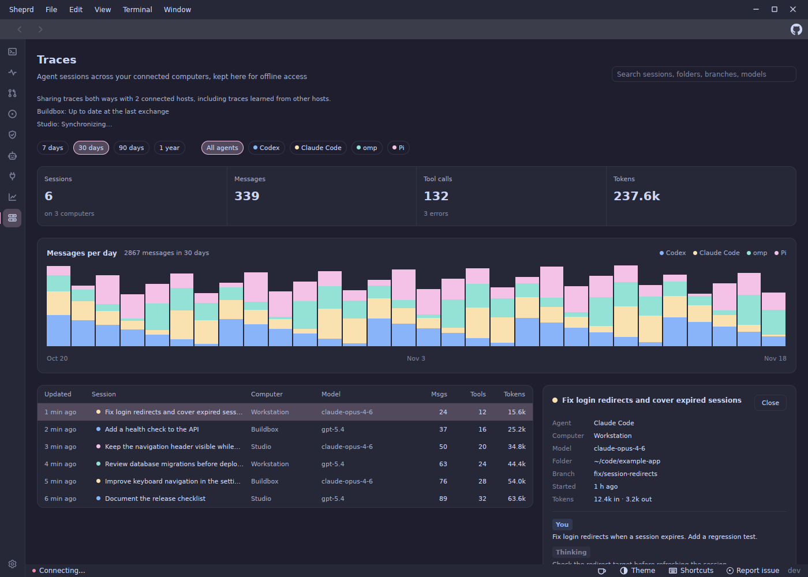
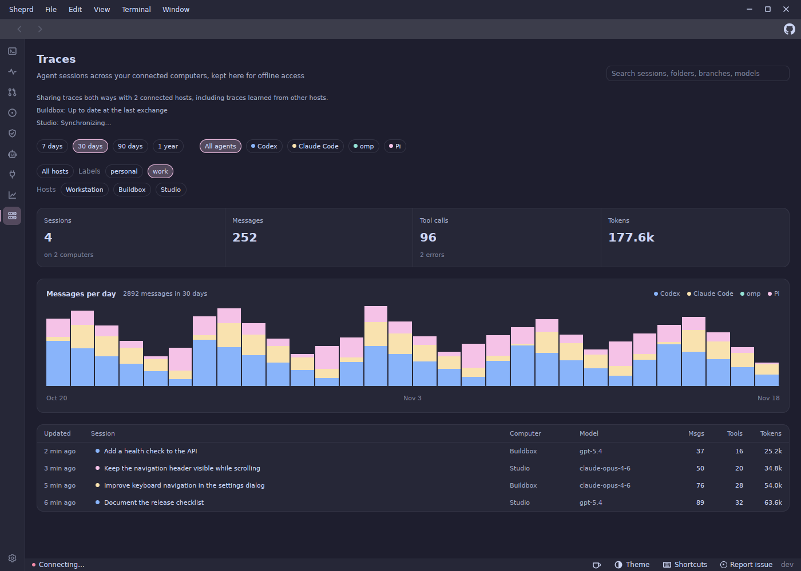
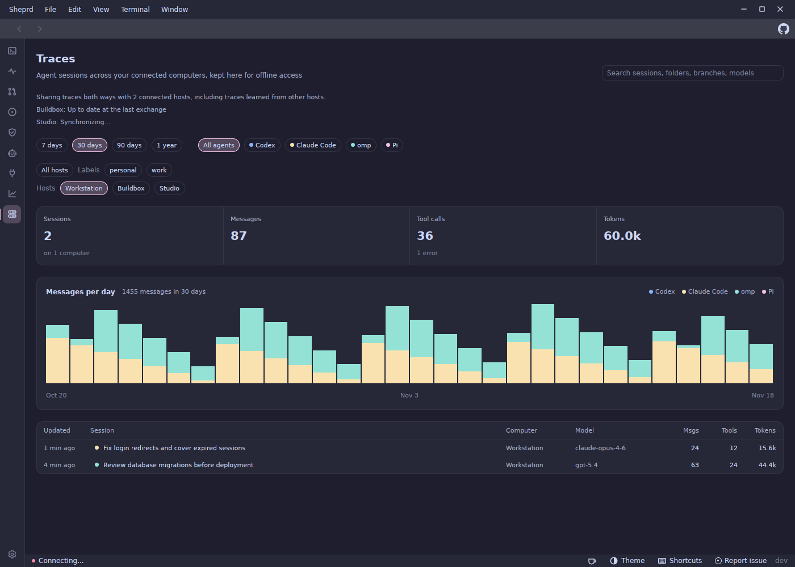
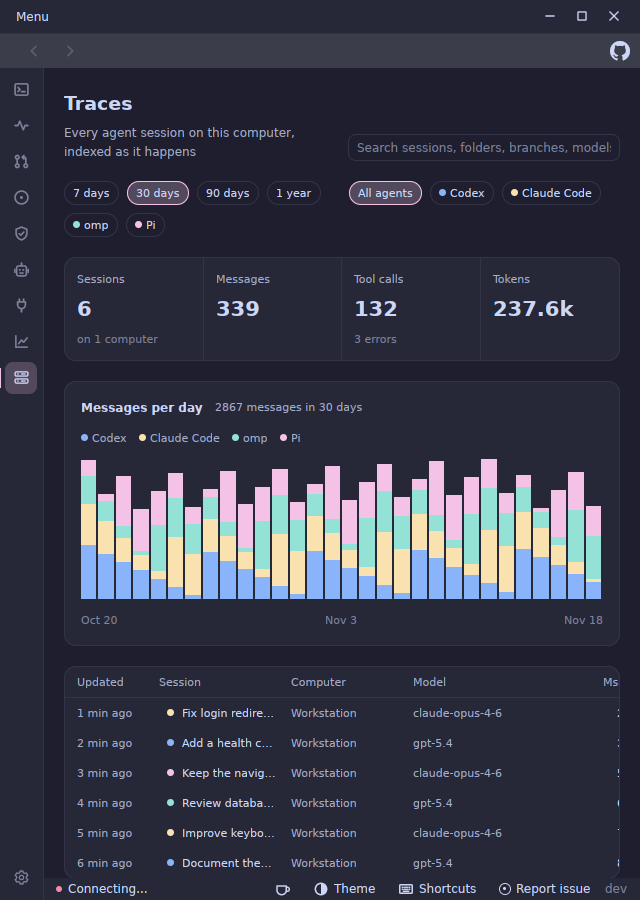

# Traces native captures

Captured from this branch's native Linux/X11 window using the isolated
`native_traces` fixture. All session content is synthetic. These are native
app captures, not browser mockups; no personal transcripts appear here.
The disconnected status bar belongs to the daemon-free fixture.
The current captures include synthetic replication status for two connected
hosts and cached sessions from three computers. They demonstrate presentation,
not a real network exchange; the replication tests exercise the exchange.

| View | Capture |
| --- | --- |
| Dark, 1400 px |  |
| Light, 1400 px |  |
| Dark, 640 px |  |
| Light, 640 px |  |
| Selected session (captured before the host-filter controls were added) |  |
| Work label: two computers |  |
| One computer |  |

## Narrow layout correction

The first capture exposed table columns clipped without a horizontal scroll
container. The final layout keeps the table in a horizontally scrollable
viewport and wraps the detail panel below it when needed.

| Before the layout correction | After the layout correction |
| --- | --- |
|  |  |

The comparison is before/after the narrow-table fix within this branch, not a
capture of `main`: Traces is a new page with no equivalent on `main`.
See [Traces](../../traces.md#native-screenshots) for the reproduction command.
